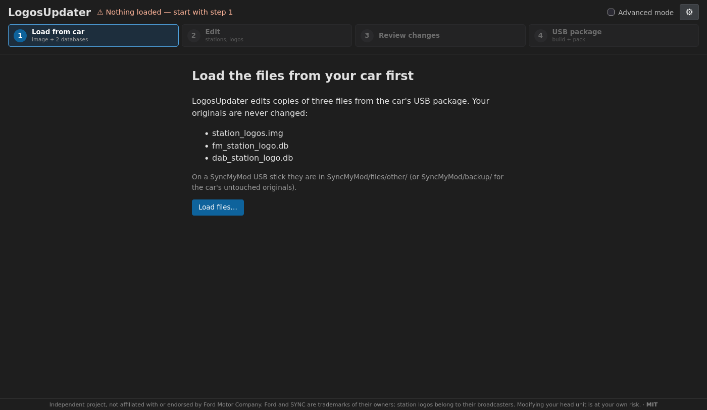
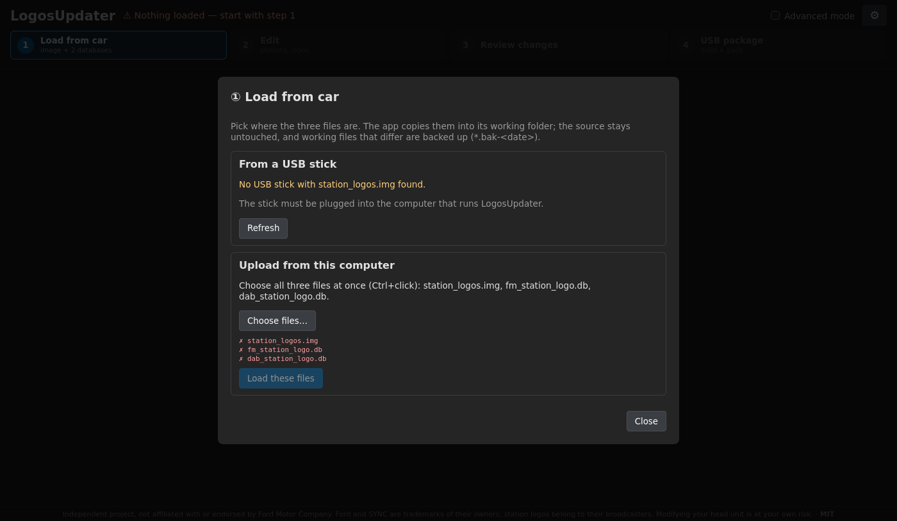
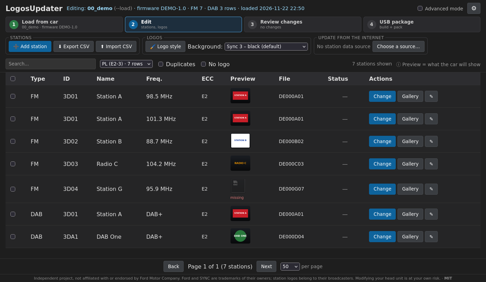
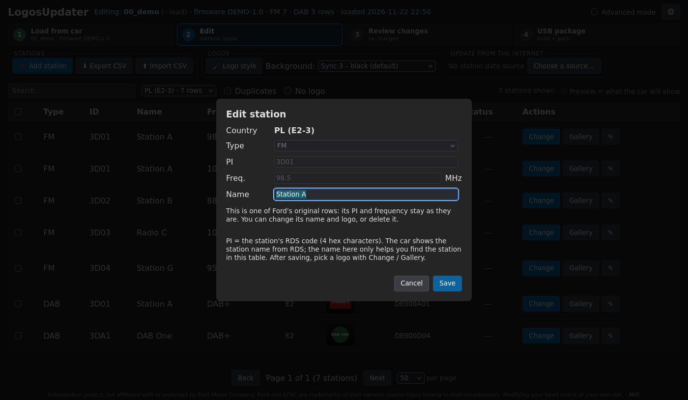
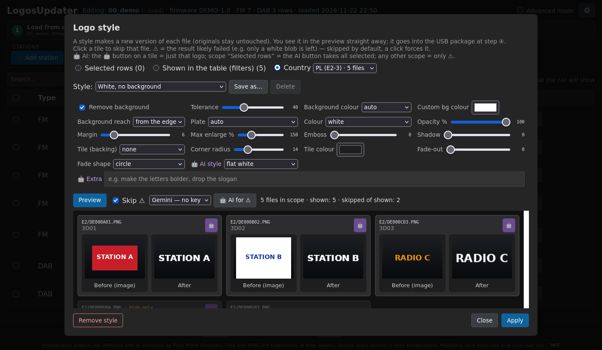
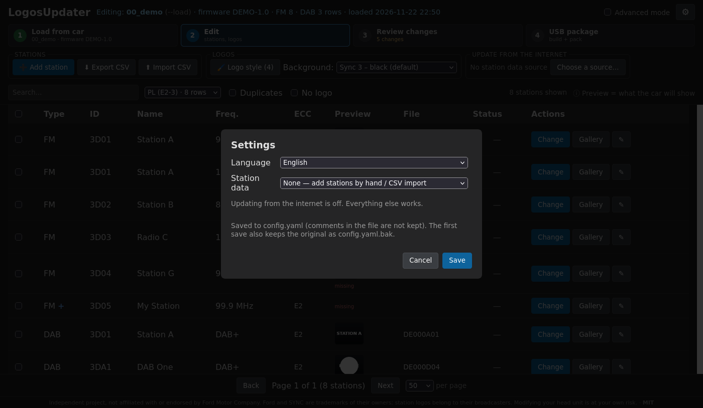
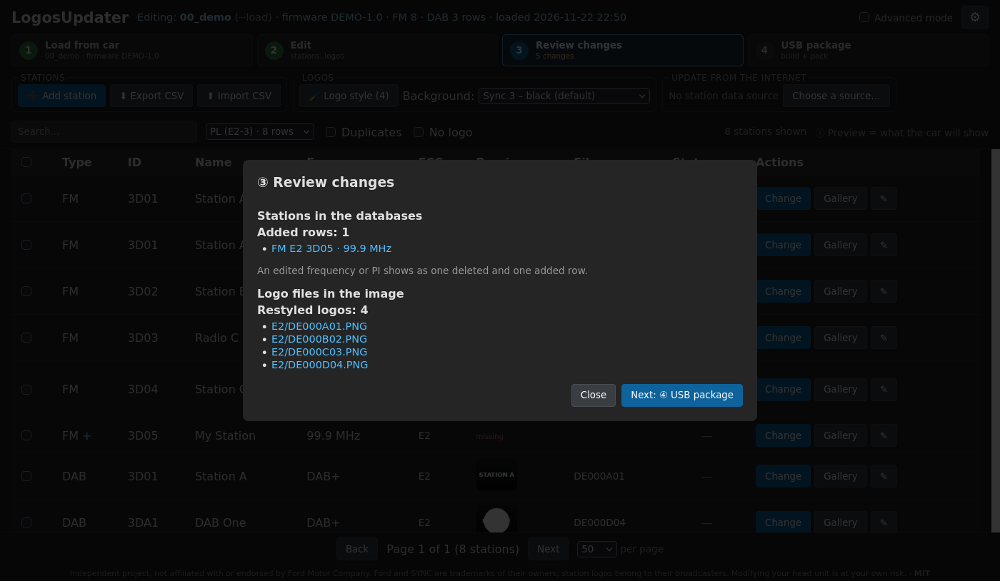
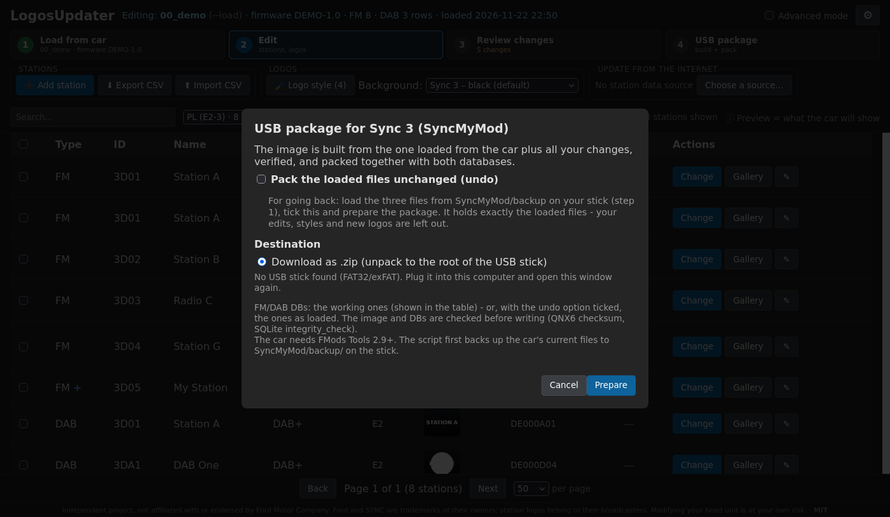
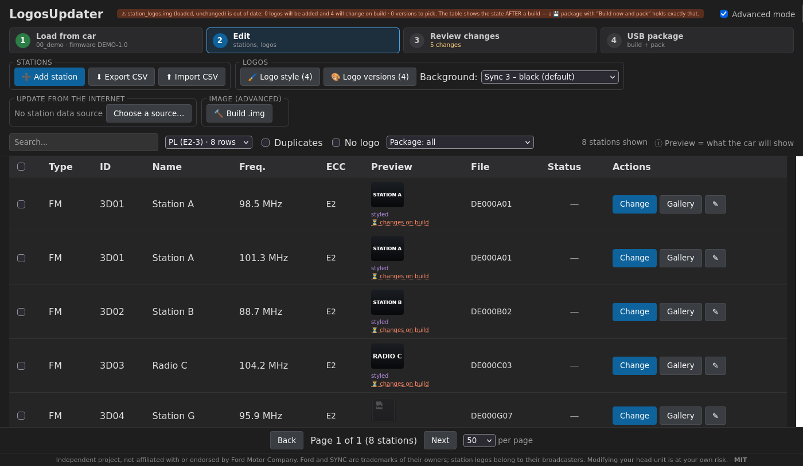

# LogosUpdater — User guide

LogosUpdater changes the radio station logos that a Ford [SYNC 3](GLOSSARY.md#sync3) screen shows
next to [FM](GLOSSARY.md#fm) and [DAB](GLOSSARY.md#dab) stations. You use it on your computer, in a
web browser. At the end you get a [USB package](GLOSSARY.md#usb-package) that you plug into the car.

You do not need to know anything about programming. This guide takes you from the download to new
logos in your car — and shows you how to go back if you change your mind.

*Polska wersja: [USER_GUIDE.pl.md](USER_GUIDE.pl.md). Unfamiliar word? See the
[glossary](GLOSSARY.md).*

**Contents**

- [What you need](#what-you-need)
- [Install and start](#install-and-start)
- [Try it without a car](#try-it-without-a-car)
- [The four steps](#the-four-steps)
- [Putting it on the car](#putting-it-on-the-car)
- [Advanced mode](#advanced-mode)
- [FAQ](#faq)
- [Disclaimer](#disclaimer)

## What you need

- **FMods Tools 2.9 or newer installed on the car.** [FMods Tools](GLOSSARY.md#fmods) is a
  community add-on for SYNC 3. It is what runs the USB package in the car. LogosUpdater does not
  install it. Look for "FMods Tools" in the Ford SYNC modding community (forums and groups); follow
  their instructions to install it. Without it, the car ignores the package.
- **A USB stick**, formatted as **FAT32** or **exFAT** (not NTFS — the car cannot read it). It needs free space for the package *and* for
  the backup the car makes on it: roughly twice the size of `station_logos.img`, plus a little.
  Once the stick holds a complete backup (`SyncMyMod/backup/`), about one image size is enough.
- **The three files from your own car**:
  - `station_logos.img` — the [logo image](GLOSSARY.md#qnx6-image) (all logos in one file),
  - `fm_station_logo.db` — which FM station gets which logo,
  - `dab_station_logo.db` — the same for DAB.

  They are usually on your [SyncMyMod](GLOSSARY.md#syncmymod) USB stick, in
  `SyncMyMod/files/other/`. After you have installed a LogosUpdater package once, the car's own
  copies are also in `SyncMyMod/backup/`. The three files must come from **your** car (same
  [firmware](GLOSSARY.md#firmware)). LogosUpdater cannot read them out of the car by itself — if
  you have never had them, the FMods community describes how to get them.
- **A computer** with Windows, macOS or Linux. An internet connection is not required for editing.

## Install and start

Pick **one** of the ways below. The ready-made file is the easiest.

### Ready-made file (Windows, macOS, Linux)

1. Open the [**Releases**](https://github.com/trololooolooolo/logosUpdater/releases) page of the LogosUpdater GitHub repository and download the file for your
   system:

   | System | File |
   |---|---|
   | Windows (64-bit) | `LogosUpdater-windows-x64.exe` |
   | macOS (Apple silicon: M1, M2, …) | `LogosUpdater-macos-arm64` |
   | Linux (64-bit) | `LogosUpdater-linux-x64` |

2. **Make a new, empty folder** (for example `LogosUpdater` in your Documents) and put the file there.
   The app keeps all its work next to the file — not straight on the Desktop.
3. Start it:
   - **Windows:** double-click the file. If Windows shows "Windows protected your PC"
     (SmartScreen), click **More info**, then **Run anyway**. This appears because the file is not
     signed by a paid certificate.
   - **macOS:** the first time, **right-click** the file and choose **Open**, then confirm **Open**.
     If macOS still refuses, open the Terminal in that folder and run:
     ```bash
     xattr -d com.apple.quarantine LogosUpdater-macos-arm64
     ```
     An Intel Mac cannot run this file; use [From source](#from-source) instead.
   - **Linux:** make the file executable once, then run it:
     ```bash
     chmod +x LogosUpdater-linux-x64
     ./LogosUpdater-linux-x64
     ```

### From source

For people who are fine with typing commands in a terminal. You need **Python 3.10 or newer**. The
app's add-on packages go into a [virtual environment](GLOSSARY.md#venv) (a private `.venv` folder),
so the rest of your system is not touched.

**1. Get the code.** Pick one:

- On the **Releases** page, download **Source code (zip)** and unpack it into a new folder.
- Or, if you have git, run:
  ```bash
  git clone https://github.com/trololooolooolo/logosUpdater.git
  cd logosUpdater
  ```

**2. Install Python** (skip this if `python3 --version`, or `py --version` on Windows, shows 3.10
or newer).

- **Linux (Ubuntu / Debian):** Python is already there. Add the venv and pip parts once:
  ```bash
  sudo apt install python3-venv python3-pip
  ```
- **Windows:** get the installer from python.org. On its first screen tick **Add python.exe to
  PATH**. Or, in a terminal: `winget install Python.Python.3.12`.
- **macOS:** get the installer from python.org (or use Homebrew: `brew install python`).

**3. Make the virtual environment and install the packages.** Open a terminal in the LogosUpdater
folder (the one with `view_stations.py`).

Linux and macOS:

```bash
python3 -m venv .venv
source .venv/bin/activate
pip install -r requirements.txt
python view_stations.py
```

Windows (Command Prompt or PowerShell):

```bat
py -m venv .venv
.venv\Scripts\activate
pip install -r requirements.txt
python view_stations.py
```

After `activate` the prompt starts with `(.venv)`. Next time you only need the `activate` line and
`python view_stations.py`. If PowerShell says that running scripts is disabled, use Command Prompt
(`cmd`) instead.

**Why the venv?** Ubuntu 23.04+ and Debian 12+ refuse `pip install` outside a venv. They show
*externally-managed-environment*. The app tries to install missing packages by itself on the first
start, but on these systems that only works inside the venv. If you see that message, go back to
step 3.

**Keep your data apart from the code (optional).** By default the app keeps its work in the code
folder. To keep it somewhere else — so a new version of the code can replace the old one — set
`LOGOSUPDATER_DATA` to a folder of your choice before you start:

- Linux / macOS: `LOGOSUPDATER_DATA=~/LogosUpdater-data python view_stations.py`
- Windows, Command Prompt: `set LOGOSUPDATER_DATA=%USERPROFILE%\LogosUpdater-data`, then
  `python view_stations.py`
- Windows, PowerShell: `$env:LOGOSUPDATER_DATA="$env:USERPROFILE\LogosUpdater-data"`, then
  `python view_stations.py`

On Windows the setting lasts until you close that window. See
[CONFIG.md — Where your data lives](CONFIG.md#where-your-data-lives).

### Docker

```bash
docker compose up -d
```

Then open <http://localhost:8000> yourself. Your work is kept in a Docker volume and survives
restarts. Inside Docker **no USB stick is detected**: load the files with *Upload from this
computer* and take the package as a `.zip` download.

### After the start

- Your **web browser opens by itself**, usually at <http://127.0.0.1:8000>. The console shows the
  real address in the line `SERVER: http://127.0.0.1:<port>`. If port 8000 is already taken by
  another program, the app says so and uses the next free port (8001, 8002, …). If the browser does
  not open, type the address from the `SERVER:` line into it. (To stop the browser from opening,
  start with `--no-browser`. To choose the port, see [the FAQ](#faq).)
- A **console window** (black text window) opens too. **Keep it open** while you work — it *is* the
  app. Closing it stops LogosUpdater. Close it when you are done. It shows only the `SERVER:` line,
  warnings and errors.
- The app only runs on your computer. Nothing is sent anywhere unless you use an update from the
  internet or the optional AI feature.

## Try it without a car

Want to look around first? You can make a small **demo set** with made-up stations ("STATION A",
"RADIO C", …). This needs the [From source](#from-source) install. Run these in the LogosUpdater
folder, with the venv activated (step 3) — then the command is `python` on every system:

```bash
python tools/demo_set.py
python view_stations.py --load inputs/00_demo
```

The second command starts the app with the demo set already loaded. (You can also load it later
from **① Load from car** in [Advanced mode](#advanced-mode), under *[Input sets](GLOSSARY.md#input-set)*.)

> **Never put a package made from the demo set on a car.** Its image and databases are fake. The
> car would show no real logos.

## The four steps

The bar at the top of the page leads you through four steps. The line next to the title
("**Editing:** …") always says which files you are working on.



### ① Load from car

Click **Load files…** (or the step **① Load from car**). You have two ways:



- **From a USB stick** — plug your SyncMyMod stick into **this computer**. The app lists the folders
  on it that contain `station_logos.img`. Click **Load** next to the right one. If nothing shows,
  click **Refresh**.
- **Upload from this computer** — click **Choose files…** and select **all three files at once**
  (hold Ctrl, or Cmd on a Mac, and click each one): `station_logos.img`, `fm_station_logo.db`,
  `dab_station_logo.db`. Each file gets a ✓ when it is recognised. Then click **Load these files**.

The app asks you to confirm *"Load …?"*. If you already have files loaded, it adds *"Your current
working files are backed up first."* Click **Load**.

The app checks the files before it uses them. It refuses a folder or an upload where one of the
three files is missing, and an image or database that is damaged or cut short (for example a copy
that did not finish). The message names the file. Nothing changes in that case: copy that file
again and retry.

**Your originals are safe.** The app copies the three files into its own folder and edits only the
copies ([working copies](GLOSSARY.md#working-copy)). The stick and the files you picked are never
changed. If you load new files over earlier work, the earlier working files are kept as
`*.bak-<date>` first.

**Your styles and new logos stay.** Logo styles (🖌), new logo files and your picks in 🎨 Logo
versions are your logo library: they stay after you load other files, and the next normal package
puts them into the image. (The confirm message says so too.) To take a style off, use **🖌 Logo
style → Remove style**. The undo option in ④ leaves them all out.

### ② Edit

After loading you see the stations of one country in a table.



**Finding stations**

- The country list (e.g. `PL (E2-3) · 7 rows`) picks the country. A country here is an
  [ECC](GLOSSARY.md#ecc) plus the first character of the [PI code](GLOSSARY.md#pi), because that is
  how the radio tells countries apart.
- **Search…** finds any text in the rows (name, ID, frequency, file name). **Duplicates** and **No logo** narrow the
  table down.
- The **Preview** column shows the logo exactly as the USB package will put it into the car
  ("Preview = what the car will show"). *missing* means the car has no logo file for that station.
- The **Status** column compares a row with your [data source](GLOSSARY.md#data-source):
  ✅ = found there; **·** = not in the source's station list; **—** = no data source is set. Neither
  **·** nor **—** is an error: the station works in the car as it is.

**Changing a logo** (buttons on each row)

- **Change** — pick a picture file on your computer. A small editor opens: you can crop and rotate
  the picture and make its white areas transparent, then **Save**. The logo is resized to fit the
  radio and set for that row.
- **Gallery** — pick a logo that is already in the image (for example one used by another station).
- To give several stations the same logo, tick their rows: a bar appears with **Change logo**,
  **Delete** and **Clear selection**.

**Stations** group

- **➕ Add station** — add an FM or DAB station that is missing from the car's list. You need its
  [RDS](GLOSSARY.md#rds) **PI code** (4 characters, e.g. `3D05`; most radios show it in the station info) and, for FM,
  the frequency. The name is optional and only helps you find the station in this table — the car
  shows the name the station broadcasts over RDS.
- **✎** on a row — edit a station. For Ford's original rows you can change only the name (and the
  logo); their PI and frequency stay as they are.

  

- **⬇ Export CSV / ⬆ Import CSV** — work on the country's station list in a spreadsheet ([CSV](GLOSSARY.md#csv) file). The import
  shows a preview first and backs up both databases before writing.

**Logos** group

- **🖌 Logo style** — give many logos one common look, e.g. *White, no background*. Choose the
  scope (selected rows, what the table shows, or a whole country), a style, click **Preview** to see
  *Before* and *After*, then **Apply**. Click a tile to skip that file. ⚠ marks results that
  probably failed (for example only a white blob is left); they are skipped by default. **Remove
  style** takes the style off again. Originals are kept.

  

  The 🤖 AI buttons are optional: they send the logos to an online AI service and need your own API
  key. You can ignore them.
- **Background:** — only changes what you see *behind* the logo previews, to judge how a logo will
  look on the car screen. The default is *Sync 3 – black*, like the car; on *none* white logos look
  like empty squares. It does not change any logo. The browser remembers your choice.

**Update from the internet** group

Only for countries with a [data source](GLOSSARY.md#data-source). Without one it says *No station
data source* and offers **Choose a source…**. With a source you get two switches — **DB
(frequencies)** and **Logo files** — and the **🔄 Update** button. Nothing is downloaded until you
press it.

**⚙ Settings** (top right) — change the language and the station data source.



### ③ Review changes

Click **③ Review changes**. The step shows the number of changes; the window lists them.



It compares your working copies with the files **as you loaded them**: stations added, deleted, or
with another logo, and logo files that are new, replaced or restyled. Click any entry to jump to
that station in the table. If it says *No changes*, the package would be the same as what you
loaded. Then click **Next: ④ USB package**.

### ④ USB package



The app builds a new logo image from the one you loaded plus all your changes, checks it, and packs
it with both databases. Choose where it goes:

- **Download as .zip** — a file `usb_logos_<date>.zip` is downloaded. It holds one folder,
  `SyncMyMod`. Put that folder on the stick as shown in
  [Copy the .zip to the stick](#copy-the-zip-to-the-stick).
- **USB stick …** — shown only when a stick is plugged into this computer. The package is first
  written to a temporary folder on the stick (`SyncMyMod.new-<date>`) and every file is checked.
  Only then is it swapped in: an existing `SyncMyMod/` folder is renamed to `SyncMyMod.old-<date>`
  (nothing is deleted), the car's backup (`SyncMyMod/backup/`) is moved into the new package, so it
  stays where it belongs, and the new folder becomes `SyncMyMod/`. You then see *"SyncMyMod/backup
  (the car's original files) was kept in the new package."* If writing fails (stick pulled out,
  write error, stick full), the temporary folder is removed and the old `SyncMyMod/` stays exactly
  as it was. Unmount ("eject") the stick before you pull it out.
  - **Space on the stick:** the package (about the size of `station_logos.img`), plus the same
    again if the stick has no complete `SyncMyMod/backup/` yet — the car writes its backup there on
    the first install.
  - **Old folders:** every direct write leaves the previous package as `SyncMyMod.old-<date>`
    (each about one image size). The app never deletes them; it tells you how many there are, and
    if the stick is too full, the error lists them. They are not needed for installing — delete them
    yourself when you need room. Never delete `SyncMyMod/backup/`.

**Pack the loaded files unchanged (undo)** — tick this to go back to the files you loaded, without
any of your edits, styles or new logos. Use it to undo everything; see [How to undo](#how-to-undo).
It is ticked by itself when you loaded the files from a `backup` folder. Without it, the package
also holds your styles and new logos — even ones made before you loaded the current files (see
*Your styles and new logos stay* under ① Load from car).

Click **Prepare**. The package contains:

```
SyncMyMod/autoinstall.sh                  the install script the car runs
SyncMyMod/README_USB.txt                  short instructions (English, then Polish)
SyncMyMod/files/other/station_logos.img   the new logo image
SyncMyMod/files/other/fm_station_logo.db
SyncMyMod/files/other/dab_station_logo.db
SyncMyMod/files/other/MANIFEST.md5        checksums
```

#### Copy the .zip to the stick

The top level of the stick must hold `SyncMyMod/` — not `usb_logos_<date>/SyncMyMod/`.

1. **If the stick already has a `SyncMyMod/` folder:** copy its `backup/` subfolder to your computer
   first (see [How to undo](#how-to-undo)). Then keep `SyncMyMod/backup/` on the stick: the new
   folder must be *merged* into the old one, not put in its place.
2. Open the zip:
   - **Windows:** double-click it. Explorer shows the `SyncMyMod` folder inside.
   - **macOS:** double-click it. Finder unpacks it into a `SyncMyMod` folder next to the zip.
   - **Linux:** double-click it, or right-click → **Extract Here**.
3. Drag the `SyncMyMod` folder onto the stick, into its top level (not into another folder).
   If the stick already has `SyncMyMod/`, you are asked what to do:
   - **Windows:** choose **Replace the files in the destination**. Windows merges the folders;
     `backup/` stays.
   - **macOS:** hold the **Option (⌥)** key while you drop and choose **Merge**. Do **not** choose
     **Replace** — that deletes the old folder, `backup/` included.
   - **Linux:** choose **Merge**, then **Replace** for the files.
4. Check: on the stick you see `SyncMyMod`, and inside it `autoinstall.sh`, `README_USB.txt` and
   `files` (and `backup`, if it was there before).

Instead of steps 2–3 you can unpack straight onto the stick: **Extract All…** (Windows) or
**Extract to…** (Linux) and pick the stick itself as the target. On Windows remove the
`usb_logos_<date>` part the wizard adds at the end of the path, so the target is just the stick
(e.g. `E:\`).

## Putting it on the car

### How to undo

Read this first — then you know you can always go back. (What a [backup](GLOSSARY.md#backup) is.)

**What the package backs up.** When the car runs the package, the script first copies the car's
current `station_logos.img`, `fm_station_logo.db` and `dab_station_logo.db` **to the USB stick**,
into `SyncMyMod/backup/`. This happens **before anything in the car is changed**. The script checks
that each copy matches the car's file (same size, and the same checksum when the car can compute
one). If the copy fails (for example the stick is
full), it deletes the half-made backup and stops. The car keeps its files.

It makes the backup **only once per stick**: a complete `SyncMyMod/backup/` is never overwritten.
Next to the three files it writes `BACKUP_INFO.txt`: the date (by the car's clock), the version of
the logo image, the file sizes and how to undo. In the car it also keeps the two databases as
`fm_station_logo.db.ori` and `dab_station_logo.db.ori` — also only once, the first time ever.

**Keep the first backup safe.**

- After your first install, copy the `SyncMyMod/backup/` folder from the stick to your computer.
  Check it has three files (and `BACKUP_INFO.txt`).
- **Do not delete `SyncMyMod/backup/`** from the stick.
- **Use one stick per car.** The backup on a stick belongs to the car it was made in.
- When LogosUpdater writes a new package straight onto the stick, it keeps `backup/` inside the new
  `SyncMyMod/`. When you copy a `.zip` package yourself, merge it into the existing `SyncMyMod/`
  (see [Copy the .zip to the stick](#copy-the-zip-to-the-stick)) so `backup/` stays where it is.
  (Sticks prepared with older versions of LogosUpdater may have the first backup in
  `SyncMyMod.old-<date>/backup/`.)

**To go back to the logos you had before — with the app (recommended):**

1. In **① Load from car**, load the three files from `SyncMyMod/backup/`: pick that folder under
   **From a USB stick**, or upload the three files from your computer copy.
2. Go to **④ USB package**. Check that **Pack the loaded files unchanged (undo)** is ticked. (It is
   ticked by itself when you load from the `backup` folder on the stick. After an upload, tick it
   yourself.)
3. Click **Prepare**. The package then holds exactly the backed-up files — your edits, styles and
   new logos are left out. (They stay in the app for later; the undo option just ignores them.)
4. Install on the car as usual (see [Install](#install)). The car gets its old files back.

**Without the app:**

1. On the stick, copy the three files from `SyncMyMod/backup/` into `SyncMyMod/files/other/`,
   replacing the files there. (`MANIFEST.md5` will no longer match; the car does not use it.)
2. Install on the car again, exactly as below. The car gets its old files back.

The `*.db.ori` copies inside the car are an extra safety net. LogosUpdater has no button to restore
them; that needs other FMods tools.

### Install

1. Make sure the stick has `SyncMyMod/` at the top level (see
   [Copy the .zip to the stick](#copy-the-zip-to-the-stick)).
2. In the car: switch the ignition on — best with the engine running.
3. Plug in the stick. The installation starts by itself and shows progress on the screen.
4. The script checks the files on the stick **before** it changes anything. It compares each file
   with the size (and, when the car supports it, the checksum) written down when the package was
   made. A missing, damaged or half-copied file stops the install, and the car is not changed.
5. Then it makes the backup on the stick (see [How to undo](#how-to-undo)). Only after that does it
   change the car's files.
6. It replaces the car's files one by one. Each new file is first copied next to the old one and
   checked; only then does it take the old one's place. If a step fails, the files already replaced
   are put back from `SyncMyMod/backup/`, and the screen says so.
7. When you see **"Installation completed. Please remove the USB stick to reboot."**, pull the
   stick out. The radio restarts.
8. Check your logos. Then copy `SyncMyMod/backup/` to your computer (see [How to undo](#how-to-undo)).

Messages you may see:

| On the screen | Meaning |
|---|---|
| *FMods Tools not found. Installation aborted.* | FMods Tools is not installed on the car. Nothing was changed. |
| *FMods Tools 2.9 or higher is required…* | Update FMods Tools. Nothing was changed. |
| *Missing … on USB. Nothing was changed.* | A package file is not on the stick. Copy the package to the stick again. |
| *File … on USB is damaged or incomplete (copy it again). Nothing was changed.* | A file on the stick differs from the one in the package (copy not finished, or a faulty stick). Copy the package to the stick again; if it happens again, use another stick. |
| *Backup already on USB (SyncMyMod/backup) - kept.* | All is fine. The backup from an earlier install stays as it is. |
| *Backup to USB failed (stick full?). Nothing was changed. Free space on the stick and try again.* | The backup could not be written. The car keeps its files. Free space on the stick (or use a bigger one) and plug it in again. |
| *SyncMyMod/backup is incomplete (…). Copy the folder to a computer, delete it from the stick and try again. Nothing was changed.* | The backup on the stick is missing a file or a file is empty. Copy the folder to your computer to keep what is there. Then delete it from the stick and plug the stick in again. |
| *Install failed (…). The car files were not changed.* | Something went wrong before any car file was replaced. The car is as before. Plug the stick in again; if it happens again, make the package again. |
| *Install failed (copying station_logos.img). The car files were not changed.* | Often: the radio has not enough free space for the new image. It copies the new image next to the old one before swapping them, so its image partition (`/fs/images`) needs about one image size free (~200 MB). Large navigation map updates can fill it. Nothing was changed. See [FAQ](#faq): *Install failed while copying station_logos.img*. |
| *Install failed (…). The original files were restored from SyncMyMod/backup.* | A file could not be replaced. The files already replaced were put back from the backup, so the car is as before. Try again; if it happens again, make the package again or use another stick. |
| *Install failed (…) and restoring the original files also failed. Restore them from SyncMyMod/backup on the stick as described in SyncMyMod/README_USB.txt.* | The car may be left with some new and some old files. Keep the stick as it is (do not delete `SyncMyMod/backup/`) and follow [How to undo](#how-to-undo) to install the backed-up files. |

## Advanced mode

Tick **Advanced mode** at the top right. The browser remembers it. You get extra tools for people
who know what they are doing:



- **🎨 Logo versions** — when a logo file exists in two versions (in the loaded image and among
  downloaded/styled logos), choose per file which one goes to the car.
- **Image (advanced) → 🔨 Build .img** — build the new logo image on its own, without a package.
- **Package: …** filter and tags under the previews (e.g. *⏳ changes on build*) — which logos will
  change when the image is built.
- In **① Load from car**: **Input sets (inputs/)** — sets of files kept in the app's `inputs/`
  folder (for example the demo set).
- In **④ USB package**: choose the image — build now, the last built one, or the loaded one
  unchanged. (To undo everything you do not need Advanced mode: see [How to undo](#how-to-undo).)

## FAQ

**The logo doesn't show in the car.**
- Check that the preview in the table is not *missing*. *missing* = the car has no logo file for that
  station.
- Check the **country** and **PI code**. The car's databases link a logo to a station by its
  country, PI code and (for FM) frequency. If one of them is wrong, the row never matches the
  station you hear. When you add a station whose PI belongs to
  another country, the app warns you.
- Make sure you installed the **new** package (look at the date in `SyncMyMod/README_USB.txt` on the stick) and
  that the installation ended with *Installation completed*.
- Don't load a package made from the demo set — it has fake data.

**The page shows something else / "Not Found" / another app.**
Another program (for example Docker or WSL) already uses the port. LogosUpdater then takes the next
free port: look at the console line `SERVER: http://127.0.0.1:<port>` and open exactly that address.
To pick the port yourself, start with `--port 8080` (e.g. `python view_stations.py --port 8080`, or
`LogosUpdater-windows-x64.exe --port 8080`), or put `port: 8080` into `config.yaml` (see
[CONFIG.md — Settings](CONFIG.md#settings)).

**After loading other files, ③ already shows restyled logos / my styles are still there.**
That is on purpose: styles, new logo files and 🎨 picks are your logo library and stay after you
load other files. They go into the next normal package. To take a style off, use **🖌 Logo style →
Remove style**. The undo option in ④ ignores them (see [How to undo](#how-to-undo)).

**The car doesn't see the USB stick / nothing happens.**
- The stick must be **FAT32** or **exFAT**. NTFS does not work.
- `SyncMyMod/` must be at the **top level** of the stick, not inside another folder (e.g. not
  `usb_logos_…/SyncMyMod/` after unpacking a zip into a folder). See
  [Copy the .zip to the stick](#copy-the-zip-to-the-stick).
- FMods Tools 2.9+ must be installed on the car.
- If the car has more than one USB port, try the other one. Some sticks simply don't work in the
  car; try another stick.

**Install failed while copying station_logos.img**

The screen says *"Install failed (copying station_logos.img). The car files were not changed."*
The car is as before: the old image is still in place. The usual reason is that the radio's image
partition (`/fs/images`) has no room for the new image next to the old one: the script copies the
new image there first and swaps it in only after the copy was checked, so for a moment both are
there. That needs about one image size free (~200 MB). On units with large navigation maps
(for example after a map update) that space may be missing.
- Plug the stick in once more: a one-off copy error goes away.
- If it fails again, the partition is probably full. LogosUpdater cannot free space on the radio.
  Ask in the FMods / Ford SYNC modding community how to free space on `/fs/images` for your unit
  (for example by removing leftovers of earlier updates) before you try again.

**The app doesn't see my USB stick.**
- The stick must be plugged into the computer that runs LogosUpdater. Click **Refresh**.
- In **④ USB package** the app offers only **FAT32** or **exFAT** sticks, because the car reads
  nothing else. An NTFS stick is not listed: reformat it as exFAT (this erases it), or take the
  `.zip` download.
- In Docker no stick is ever visible: use *Upload from this computer* and the `.zip` download.

**Loading says a file is damaged or missing.**
The app loads only a complete, readable set: `station_logos.img`, `fm_station_logo.db` and
`dab_station_logo.db`. The message names the file it does not accept. Nothing was changed. Copy
that file from the stick again (a copy that did not finish is the usual cause) and load again.

**I'm not in Poland / there is no data source for my country.**
Everything works without a data source: loading, changing logos, styles, adding stations by hand,
CSV import and the USB package. A data source only adds automatic updates. In **⚙ Settings →
Station data** you can choose *RadioPolska.pl (Poland)*, *My CSV file (any country)* (your own list
of stations) or *None*.

**What do the numbers in "③ Review changes" count?**
Each changed station row and each changed logo file counts once. So:
- a new station = 1; a deleted station = 1;
- an edited frequency or PI = 2 (one row deleted, one added);
- a new logo for a station = 1 for the row, plus 1 for the new file;
- a style applied to one logo file = 1, even if several stations use that file.

The comparison is always with the files as you loaded them, not with what is in the car right now.

**Where is my data? How do I back it up?**
Everything the app writes is in one folder:

- ready-made file: the folder where you put the file,
- from source: the folder with `view_stations.py` (or the folder you set in `LOGOSUPDATER_DATA`),
- Docker: the volume `logosupdater-data`.

Your working copies are in its `work/` subfolder, ready packages in `usb_package/` (the 3 newest are
kept). To back up your work or move to another computer, copy the whole folder. Details:
[CONFIG.md — Where your data lives](CONFIG.md#where-your-data-lives).

## Disclaimer

LogosUpdater is an independent community project. It is **not affiliated with, endorsed by or
supported by Ford Motor Company**. *Ford* and *SYNC* are trademarks of their owners and are named
here only to describe compatibility. Station logos belong to their broadcasters; none are shipped
with this app — you work with the files from your own car. Changing your [head unit](GLOSSARY.md#head-unit) is **at your own
risk** and may affect your warranty. Always keep the backup the USB package makes.
