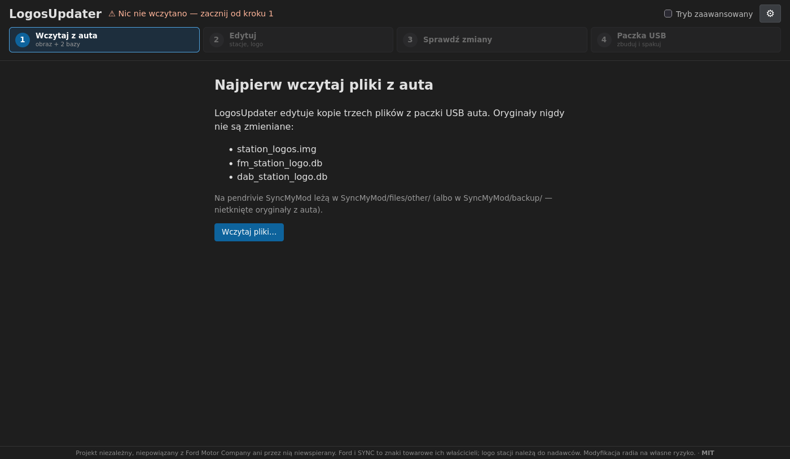
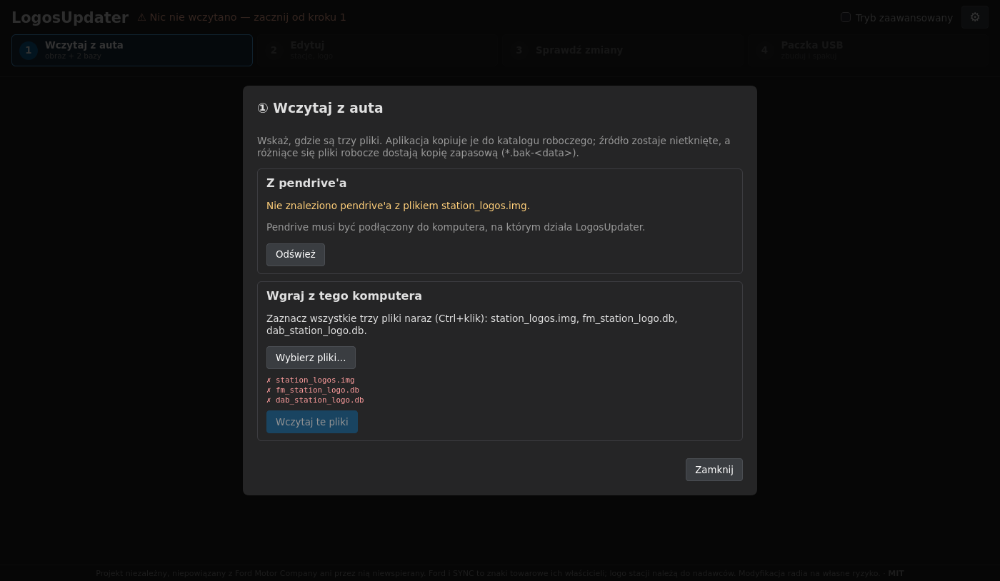
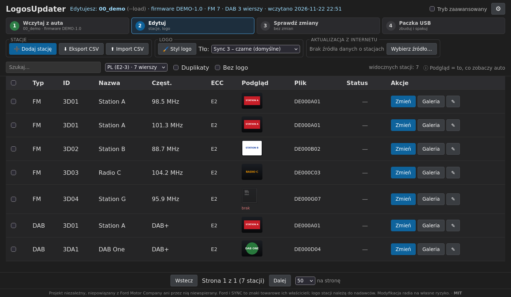
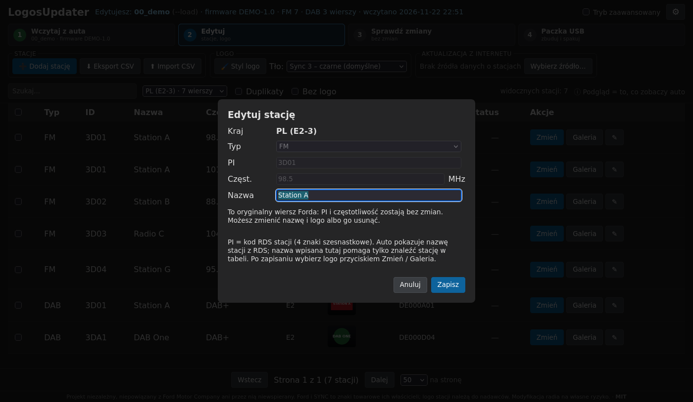
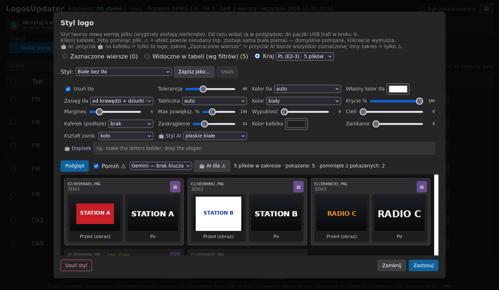
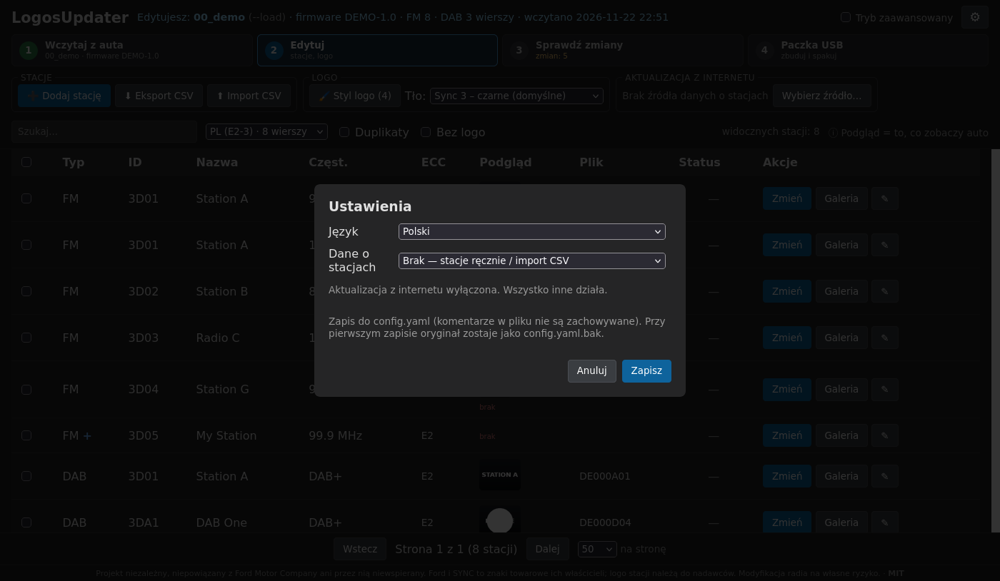
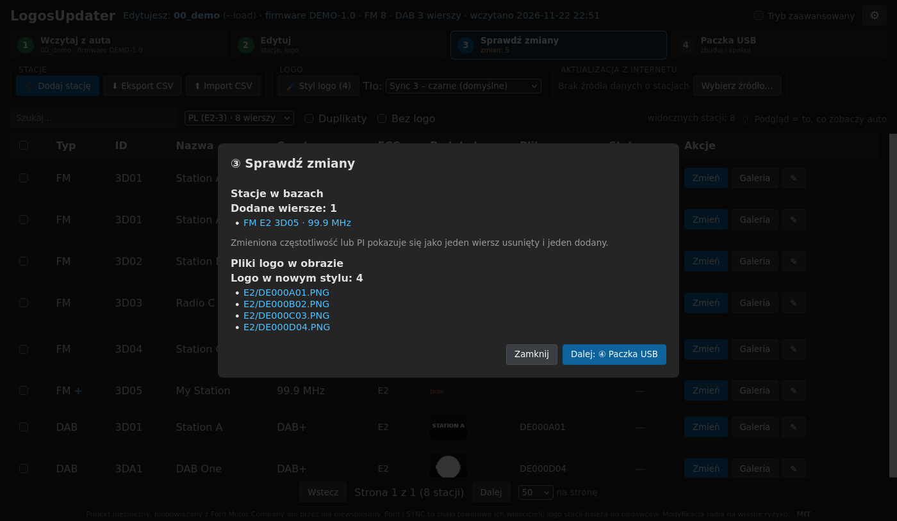
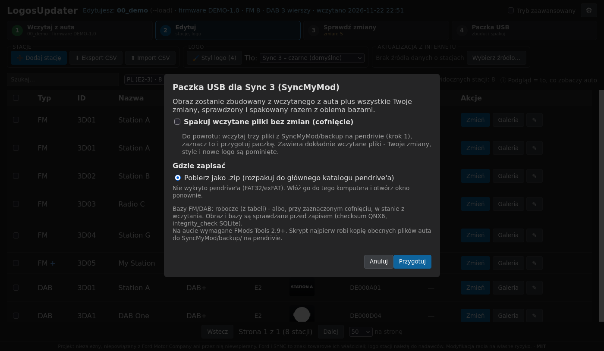
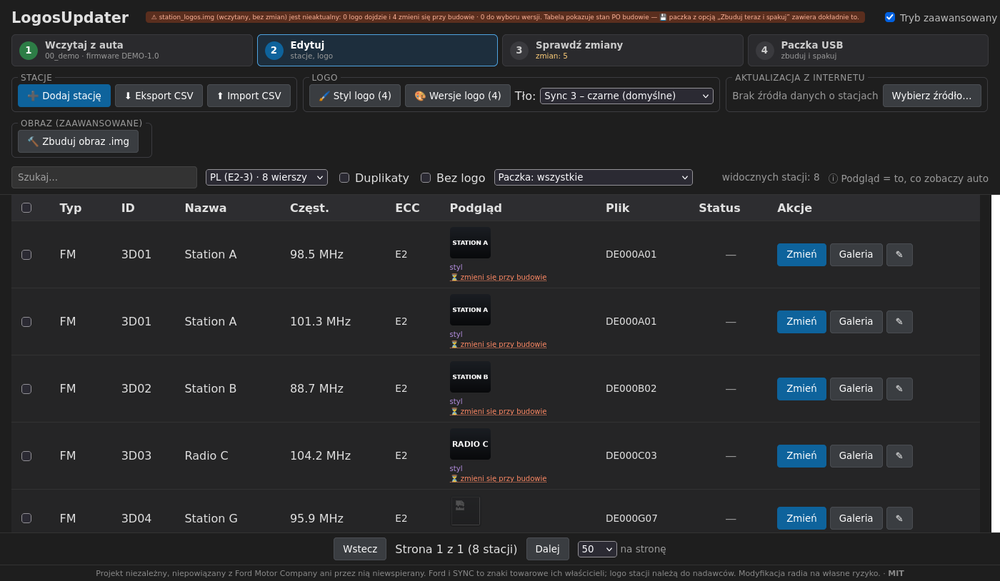

# LogosUpdater — Instrukcja użytkownika

LogosUpdater zmienia logo stacji radiowych, które ekran Forda [SYNC 3](GLOSSARY.md#pl-sync3)
pokazuje przy stacjach [FM](GLOSSARY.md#pl-fm) i [DAB](GLOSSARY.md#pl-dab). Pracujesz na swoim
komputerze, w przeglądarce. Na końcu dostajesz [paczkę USB](GLOSSARY.md#pl-usb-package), którą
wkładasz do auta.

Nie musisz znać się na programowaniu. Ta instrukcja prowadzi od pobrania aplikacji do nowych logo
w aucie — i pokazuje, jak wrócić do stanu sprzed zmian.

*English version: [USER_GUIDE.md](USER_GUIDE.md). Nieznane słowo? Zajrzyj do
[słowniczka](GLOSSARY.md#slowniczek-pl).*

**Spis treści**

- [Czego potrzebujesz](#czego-potrzebujesz)
- [Instalacja i uruchomienie](#instalacja-i-uruchomienie)
- [Wypróbuj bez auta](#wypróbuj-bez-auta)
- [Cztery kroki](#cztery-kroki)
- [Wgrywanie do auta](#wgrywanie-do-auta)
- [Tryb zaawansowany](#tryb-zaawansowany)
- [Pytania i odpowiedzi](#pytania-i-odpowiedzi)
- [Zastrzeżenia](#zastrzeżenia)

## Czego potrzebujesz

- **FMods Tools w wersji 2.9 lub nowszej, zainstalowane w aucie.** [FMods Tools](GLOSSARY.md#pl-fmods)
  to dodatek do SYNC 3 tworzony przez społeczność. To on uruchamia paczkę USB w aucie. LogosUpdater
  go nie instaluje. Szukaj „FMods Tools” w społeczności zajmującej się modyfikacjami Ford SYNC (fora,
  grupy) i postępuj zgodnie z ich instrukcją. Bez tego auto zignoruje paczkę.
- **Pendrive** sformatowany jako **FAT32** lub **exFAT** (nie NTFS — auto go nie odczyta). Musi mieć miejsce na paczkę *i* na kopię
  zapasową, którą auto na nim zrobi: mniej więcej dwa razy tyle, ile zajmuje `station_logos.img`,
  plus trochę zapasu. Gdy na pendrivie jest już pełna kopia zapasowa (`SyncMyMod/backup/`), wystarczy
  mniej więcej jeden rozmiar obrazu.
- **Trzy pliki z Twojego auta**:
  - `station_logos.img` — [obraz z logo](GLOSSARY.md#pl-qnx6-image) (wszystkie logo w jednym pliku),
  - `fm_station_logo.db` — która stacja FM ma które logo,
  - `dab_station_logo.db` — to samo dla DAB.

  Zwykle są na Twoim pendrivie [SyncMyMod](GLOSSARY.md#pl-syncmymod), w katalogu
  `SyncMyMod/files/other/`. Po pierwszej instalacji paczki z LogosUpdater kopie plików z auta są też
  w `SyncMyMod/backup/`. Pliki muszą pochodzić z **Twojego** auta (ten sam
  [firmware](GLOSSARY.md#pl-firmware)). LogosUpdater nie potrafi sam odczytać ich z auta — jeśli
  nigdy ich nie miałeś, społeczność FMods opisuje, jak je zdobyć.
- **Komputer** z Windows, macOS albo Linuksem. Do edycji internet nie jest potrzebny.

## Instalacja i uruchomienie

Wybierz **jeden** z poniższych sposobów. Najprostszy jest gotowy plik.

### Gotowy plik (Windows, macOS, Linux)

1. Otwórz stronę [**Releases**](https://github.com/trololooolooolo/logosUpdater/releases) repozytorium LogosUpdater na GitHubie i pobierz plik dla swojego
   systemu:

   | System | Plik |
   |---|---|
   | Windows (64-bit) | `LogosUpdater-windows-x64.exe` |
   | macOS (Apple silicon: M1, M2, …) | `LogosUpdater-macos-arm64` (nie w każdym wydaniu) |
   | Linux (64-bit) | `LogosUpdater-linux-x64` |

   Na tej stronie nie ma jeszcze pliku dla Twojego systemu? Skorzystaj z punktu **Ze źródeł** poniżej.

2. **Załóż nowy, pusty katalog** (np. `LogosUpdater` w Dokumentach) i włóż tam plik. Aplikacja
   trzyma całą swoją pracę obok pliku — nie kładź go wprost na Pulpicie.
3. Uruchom:
   - **Windows:** kliknij plik dwukrotnie. Jeśli Windows pokaże „System Windows ochronił ten komputer”
     (SmartScreen), kliknij **Więcej informacji**, a potem **Uruchom mimo to**. Komunikat pojawia się,
     bo plik nie jest podpisany płatnym certyfikatem.
   - **macOS:** za pierwszym razem kliknij plik **prawym przyciskiem** i wybierz **Otwórz**, potem
     potwierdź **Otwórz**. Jeśli macOS dalej odmawia, otwórz Terminal w tym katalogu i wpisz:
     ```bash
     xattr -d com.apple.quarantine LogosUpdater-macos-arm64
     ```
     Mac z procesorem Intel nie uruchomi tego pliku — użyj sposobu [Ze źródeł](#ze-źródeł).
   - **Linux:** raz nadaj plikowi prawo uruchamiania, potem go uruchom:
     ```bash
     chmod +x LogosUpdater-linux-x64
     ./LogosUpdater-linux-x64
     ```

### Ze źródeł

Dla osób, które nie boją się wpisywania poleceń w terminalu. Potrzebny jest **Python 3.10 lub
nowszy**. Dodatki, których potrzebuje aplikacja, trafiają do
[środowiska wirtualnego](GLOSSARY.md#pl-venv) (osobny katalog `.venv`), więc reszta systemu zostaje
nietknięta.

**1. Pobierz kod.** Wybierz jedno:

- Na [stronie repozytorium](https://github.com/trololooolooolo/logosUpdater) kliknij zielony przycisk **Code** → **Download ZIP** i rozpakuj go do nowego katalogu.
- Albo, jeśli masz git, wpisz:
  ```bash
  git clone https://github.com/trololooolooolo/logosUpdater.git
  cd logosUpdater
  ```

**2. Zainstaluj Pythona** (pomiń, jeśli `python3 --version`, a na Windows `py --version`, pokazuje
3.10 lub nowszy).

- **Linux (Ubuntu / Debian):** Python już jest. Raz doinstaluj części venv i pip:
  ```bash
  sudo apt install python3-venv python3-pip
  ```
- **Windows:** pobierz instalator z python.org. Na jego pierwszym ekranie zaznacz **Add python.exe
  to PATH**. Albo w terminalu: `winget install Python.Python.3.12`.
- **macOS:** pobierz instalator z python.org (albo przez Homebrew: `brew install python`).

**3. Utwórz środowisko wirtualne i zainstaluj dodatki.** Otwórz terminal w katalogu LogosUpdater
(tym z `view_stations.py`).

Linux i macOS:

```bash
python3 -m venv .venv
source .venv/bin/activate
pip install -r requirements.txt
python view_stations.py
```

Windows (Wiersz polecenia albo PowerShell):

```bat
py -m venv .venv
.venv\Scripts\activate
pip install -r requirements.txt
python view_stations.py
```

Po `activate` wiersz poleceń zaczyna się od `(.venv)`. Następnym razem wystarczy linia z `activate`
i `python view_stations.py`. Jeśli PowerShell odpowie, że uruchamianie skryptów jest wyłączone, użyj
Wiersza polecenia (`cmd`).

**Po co venv?** Ubuntu 23.04+ i Debian 12+ odmawiają `pip install` poza venv. Pokazują
*externally-managed-environment*. Aplikacja przy pierwszym uruchomieniu sama próbuje doinstalować
brakujące dodatki, ale w tych systemach działa to tylko w venv. Jeśli widzisz ten komunikat, wróć do
kroku 3.

**Dane osobno od kodu (opcjonalnie).** Domyślnie aplikacja trzyma swoją pracę w katalogu z kodem.
Żeby trzymać ją gdzie indziej — wtedy nowa wersja kodu może po prostu zastąpić starą — przed
uruchomieniem ustaw `LOGOSUPDATER_DATA` na wybrany katalog:

- Linux / macOS: `LOGOSUPDATER_DATA=~/LogosUpdater-dane python view_stations.py`
- Windows, wiersz polecenia (cmd): `set LOGOSUPDATER_DATA=%USERPROFILE%\LogosUpdater-dane`, potem
  `python view_stations.py`
- Windows, PowerShell: `$env:LOGOSUPDATER_DATA="$env:USERPROFILE\LogosUpdater-dane"`, potem
  `python view_stations.py`

Na Windows to ustawienie działa do zamknięcia tego okna. Zob.
[CONFIG.md — Where your data lives](CONFIG.md#where-your-data-lives) (po angielsku).

### Docker

```bash
docker compose up -d
```

Potem sam otwórz <http://localhost:8000>. Twoja praca jest trzymana w wolumenie Dockera i przetrwa
restart. W Dockerze **pendrive nie jest wykrywany**: wczytaj pliki przez *Wgraj z tego komputera*,
a paczkę pobierz jako `.zip`.

### Po uruchomieniu

- **Przeglądarka otworzy się sama**, zwykle pod adresem <http://127.0.0.1:8000>. Prawdziwy adres
  podaje konsola w linii `SERVER: http://127.0.0.1:<port>`. Jeśli port 8000 zajmuje już inny program,
  aplikacja to napisze i weźmie następny wolny port (8001, 8002, …). Jeśli przeglądarka się nie
  otworzy, wpisz w niej adres z linii `SERVER:`. (Żeby przeglądarka się nie otwierała, uruchom
  z `--no-browser`. Jak wybrać port — zob. [Pytania i odpowiedzi](#pytania-i-odpowiedzi).)
- Otworzy się też **okno konsoli** (czarne okno z tekstem). **Nie zamykaj go** podczas pracy — to
  *jest* aplikacja. Zamknięcie okna wyłącza LogosUpdater. Zamknij je, gdy skończysz. Konsola pokazuje
  tylko linię `SERVER:`, ostrzeżenia i błędy.
- Aplikacja działa tylko na Twoim komputerze. Nic nie jest nigdzie wysyłane, chyba że użyjesz
  aktualizacji z internetu albo opcjonalnej funkcji AI.

## Wypróbuj bez auta

Chcesz się najpierw rozejrzeć? Możesz zrobić mały **zestaw demonstracyjny** z wymyślonymi stacjami
(„STATION A”, „RADIO C”, …). Potrzebna jest instalacja [Ze źródeł](#ze-źródeł). Uruchom te polecenia
w katalogu LogosUpdater, z włączonym venv (krok 3) — wtedy na każdym systemie polecenie to `python`:

```bash
python tools/demo_set.py
python view_stations.py --load inputs/00_demo
```

Drugie polecenie uruchamia aplikację z już wczytanym zestawem demo. (Można go też wczytać później
w **① Wczytaj z auta** w [Trybie zaawansowanym](#tryb-zaawansowany), w części *[Zestawy](GLOSSARY.md#pl-input-set)*.)

> **Nigdy nie wgrywaj do auta paczki zrobionej z zestawu demo.** Jego obraz i bazy są zmyślone. Auto
> nie pokazałoby żadnych prawdziwych logo.

## Cztery kroki

Pasek u góry strony prowadzi przez cztery kroki. Linia obok tytułu („**Edytujesz:** …”) zawsze mówi,
na jakich plikach pracujesz.



### ① Wczytaj z auta

Kliknij **Wczytaj pliki…** (albo krok **① Wczytaj z auta**). Są dwa sposoby:



- **Z pendrive'a** — włóż pendrive SyncMyMod do **tego komputera**. Aplikacja pokaże katalogi na nim,
  w których jest `station_logos.img`. Kliknij **Wczytaj** przy właściwym. Jeśli nic się nie pokazuje,
  kliknij **Odśwież**.
- **Wgraj z tego komputera** — kliknij **Wybierz pliki…** i zaznacz **wszystkie trzy pliki naraz**
  (przytrzymaj Ctrl, na Macu Cmd, i kliknij każdy): `station_logos.img`, `fm_station_logo.db`,
  `dab_station_logo.db`. Rozpoznany plik dostaje ✓. Potem kliknij **Wczytaj te pliki**.

Aplikacja prosi o potwierdzenie *„Wczytać …?”*. Jeśli masz już wczytane pliki, dopisuje *„Obecne
pliki robocze zostaną najpierw zarchiwizowane.”* Kliknij **Wczytaj**.

Aplikacja sprawdza pliki, zanim ich użyje. Odrzuca katalog albo wgrane pliki, gdy brakuje jednego
z trzech plików, a także obraz lub bazę, które są uszkodzone albo ucięte (np. kopia, która się nie
dokończyła). Komunikat podaje nazwę pliku. Wtedy nic się nie zmienia: skopiuj ten plik jeszcze raz
i spróbuj ponownie.

**Twoje oryginały są bezpieczne.** Aplikacja kopiuje trzy pliki do swojego katalogu i edytuje tylko
kopie ([kopie robocze](GLOSSARY.md#pl-working-copy)). Pendrive i wskazane pliki nigdy nie są
zmieniane. Jeśli wczytasz nowe pliki na wcześniejszą pracę, wcześniejsze pliki robocze zostają
najpierw zachowane jako `*.bak-<data>`.

**Twoje style i nowe logo zostają.** Style logo (🖌), nowe pliki logo i Twoje wybory w 🎨 Wersje logo
to Twoja biblioteka logo: zostają po wczytaniu innych plików, a następna zwykła paczka wstawi je do
obrazu. (Mówi o tym też okno potwierdzenia.) Styl zdejmiesz przez **🖌 Styl logo → Usuń styl**. Opcja
cofnięcia w ④ pomija je wszystkie.

### ② Edytuj

Po wczytaniu widzisz w tabeli stacje jednego kraju.



**Szukanie stacji**

- Lista krajów (np. `PL (E2-3) · 7 wierszy`) wybiera kraj. Kraj to tutaj [ECC](GLOSSARY.md#pl-ecc)
  plus pierwszy znak [kodu PI](GLOSSARY.md#pl-pi), bo tak radio rozróżnia kraje.
- **Szukaj...** znajduje dowolny tekst w wierszach (nazwa, ID, częstotliwość, nazwa pliku).
  **Duplikaty** i **Bez logo** zawężają tabelę.
- Kolumna **Podgląd** pokazuje logo dokładnie tak, jak paczka USB wgra je do auta („Podgląd = to, co
  zobaczy auto”). *brak* oznacza, że auto nie ma pliku logo dla tej stacji.
- Kolumna **Status** porównuje wiersz z Twoim [źródłem danych](GLOSSARY.md#pl-data-source):
  ✅ = jest w nim; **·** = nie ma go na liście stacji źródła; **—** = nie ustawiono źródła danych.
  Ani **·**, ani **—** nie jest błędem: stacja działa w aucie bez zmian.

**Zmiana logo** (przyciski w każdym wierszu)

- **Zmień** — wybierz obrazek z komputera. Otworzy się mały edytor: możesz przyciąć i obrócić
  obrazek oraz zamienić białe obszary na przezroczyste, potem **Zapisz**. Logo zostanie
  przeskalowane do rozmiaru radia i ustawione dla tego wiersza.
- **Galeria** — wybierz logo, które już jest w obrazie (np. używane przez inną stację).
- Żeby dać kilku stacjom to samo logo, zaznacz ich wiersze: pojawi się pasek z przyciskami **Zmień
  logo**, **Usuń** i **Odznacz**.

Grupa **Stacje**

- **➕ Dodaj stację** — dodaj stację FM lub DAB, której brakuje na liście auta. Potrzebny jest jej
  **kod PI** z [RDS](GLOSSARY.md#pl-rds) (4 znaki, np. `3D05`; większość radioodbiorników pokazuje go w informacjach
  o stacji) i, dla FM, częstotliwość. Nazwa jest opcjonalna i pomaga tylko znaleźć stację w tabeli —
  auto pokazuje nazwę, którą stacja nadaje przez RDS.
- **✎** w wierszu — edycja stacji. W oryginalnych wierszach Forda zmienisz tylko nazwę (i logo);
  PI i częstotliwość zostają bez zmian.

  

- **⬇ Eksport CSV / ⬆ Import CSV** — praca na liście stacji kraju w arkuszu kalkulacyjnym (plik [CSV](GLOSSARY.md#pl-csv)). Import
  najpierw pokazuje podgląd i przed zapisem robi kopię obu baz.

Grupa **Logo**

- **🖌 Styl logo** — nadaj wielu logo wspólny wygląd, np. *Białe bez tła*. Wybierz zakres
  (zaznaczone wiersze, to, co widać w tabeli, albo cały kraj), styl, kliknij **Podgląd**, żeby
  zobaczyć *Przed* i *Po*, potem **Zastosuj**. Kliknięcie kafelka pomija ten plik. ⚠ oznacza
  efekt, który pewnie się nie udał (np. została sama biała plama); takie są domyślnie pomijane.
  **Usuń styl** zdejmuje styl. Oryginały zostają.

  

  Przyciski 🤖 AI są opcjonalne: wysyłają logo do internetowej usługi AI i wymagają własnego klucza
  API. Możesz je pominąć.
- **Tło:** — zmienia tylko to, co widzisz *pod* podglądami logo, żeby ocenić, jak logo wypadnie na
  ekranie auta. Domyślne jest *Sync 3 – czarne*, jak w aucie; przy *bez tła* białe logo wyglądają jak
  puste kwadraty. Nie zmienia żadnego logo. Przeglądarka zapamiętuje wybór.

Grupa **Aktualizacja z internetu**

Tylko dla krajów, dla których jest [źródło danych](GLOSSARY.md#pl-data-source). Bez źródła widać
*Brak źródła danych o stacjach* i przycisk **Wybierz źródło…**. Ze źródłem są dwa przełączniki —
**Baza (częstotliwości)** i **Pliki logo** — oraz przycisk **🔄 Aktualizuj**. Nic nie jest
pobierane, dopóki go nie naciśniesz.

**⚙ Ustawienia** (w prawym górnym rogu) — zmiana języka i źródła danych o stacjach.



### ③ Sprawdź zmiany

Kliknij **③ Sprawdź zmiany**. Krok pokazuje liczbę zmian, a okno je wypisuje.



Porównuje Twoje kopie robocze z plikami **z chwili wczytania**: stacje dodane, usunięte albo
z innym logo oraz pliki logo nowe, podmienione albo w nowym stylu. Kliknij pozycję, żeby przejść do
tej stacji w tabeli. Jeśli widzisz *Bez zmian*, paczka byłaby taka sama jak wczytane pliki. Potem
kliknij **Dalej: ④ Paczka USB**.

### ④ Paczka USB



Aplikacja buduje nowy obraz z logo z wczytanego obrazu plus wszystkich Twoich zmian, sprawdza go
i pakuje razem z obiema bazami. Wybierz, gdzie zapisać:

- **Pobierz jako .zip** — pobierze się plik `usb_logos_<data>.zip`. Jest w nim jeden katalog,
  `SyncMyMod`. Połóż ten katalog na pendrivie tak, jak opisuje
  [Kopiowanie .zip na pendrive](#kopiowanie-zip-na-pendrive).
- **Pendrive …** — widoczne tylko, gdy pendrive jest podłączony do tego komputera. Paczka jest
  najpierw zapisywana do katalogu tymczasowego na pendrivie (`SyncMyMod.new-<data>`), a każdy plik
  jest sprawdzany. Dopiero wtedy następuje podmiana: istniejący katalog `SyncMyMod/` dostaje nazwę
  `SyncMyMod.old-<data>` (nic nie jest kasowane), kopia zapasowa auta (`SyncMyMod/backup/`) jest
  przenoszona do nowej paczki, więc zostaje na swoim miejscu, a nowy katalog staje się `SyncMyMod/`.
  Zobaczysz wtedy *„SyncMyMod/backup (oryginalne pliki auta) został zachowany w nowej paczce.”*
  Jeśli zapis się nie uda (wyjęty pendrive, błąd zapisu, brak miejsca), katalog tymczasowy jest
  usuwany, a stary `SyncMyMod/` zostaje dokładnie taki, jaki był. Przed wyjęciem pendrive'a odmontuj
  go („wysuń”).
  - **Miejsce na pendrivie:** paczka (mniej więcej rozmiar `station_logos.img`) i drugie tyle,
    jeśli na pendrivie nie ma jeszcze pełnej kopii `SyncMyMod/backup/` — auto zapisze ją tam przy
    pierwszej instalacji.
  - **Stare katalogi:** każdy zapis wprost na pendrive zostawia poprzednią paczkę jako
    `SyncMyMod.old-<data>` (każdy mniej więcej rozmiaru obrazu). Aplikacja nigdy ich nie kasuje;
    mówi, ile ich jest, a gdy na pendrivie brakuje miejsca, komunikat błędu je wymienia. Nie są
    potrzebne do instalacji — usuń je sam, gdy potrzebujesz miejsca. Nigdy nie usuwaj
    `SyncMyMod/backup/`.

**Spakuj wczytane pliki bez zmian (cofnięcie)** — zaznacz, żeby wrócić do wczytanych plików, bez
Twoich zmian, stylów i nowych logo. Służy do cofnięcia wszystkiego; zob.
[Jak cofnąć zmiany](#jak-cofnąć-zmiany). Zaznacza się samo, gdy pliki wczytano z katalogu `backup`.
Bez tej opcji paczka zawiera też Twoje style i nowe logo — także te zrobione przed wczytaniem
obecnych plików (zob. *Twoje style i nowe logo zostają* w ① Wczytaj z auta).

Kliknij **Przygotuj**. Paczka zawiera:

```
SyncMyMod/autoinstall.sh                  skrypt instalacyjny uruchamiany przez auto
SyncMyMod/README_USB.txt                  krótka instrukcja (najpierw po angielsku, potem po polsku)
SyncMyMod/files/other/station_logos.img   nowy obraz z logo
SyncMyMod/files/other/fm_station_logo.db
SyncMyMod/files/other/dab_station_logo.db
SyncMyMod/files/other/MANIFEST.md5        sumy kontrolne
```

#### Kopiowanie .zip na pendrive

Na samej górze pendrive'a musi być `SyncMyMod/` — a nie `usb_logos_<data>/SyncMyMod/`.

1. **Jeśli na pendrivie jest już katalog `SyncMyMod/`:** najpierw skopiuj jego podkatalog `backup/`
   na komputer (zob. [Jak cofnąć zmiany](#jak-cofnąć-zmiany)). Potem zostaw `SyncMyMod/backup/` na
   pendrivie: nowy katalog trzeba *scalić* ze starym, a nie wstawić w jego miejsce.
2. Otwórz zip:
   - **Windows:** kliknij go dwukrotnie. Eksplorator pokaże w środku katalog `SyncMyMod`.
   - **macOS:** kliknij go dwukrotnie. Finder rozpakuje go do katalogu `SyncMyMod` obok zipa.
   - **Linux:** kliknij go dwukrotnie albo prawym przyciskiem → **Rozpakuj tutaj**.
3. Przeciągnij katalog `SyncMyMod` na pendrive, na samą górę (nie do innego katalogu). Jeśli na
   pendrivie jest już `SyncMyMod/`, system zapyta, co zrobić:
   - **Windows:** wybierz **Zamień pliki w miejscu docelowym**. Windows scali katalogi; `backup/`
     zostaje.
   - **macOS:** przytrzymaj klawisz **Option (⌥)** przy upuszczaniu i wybierz **Scal**. **Nie**
     wybieraj **Zastąp** — to usuwa stary katalog razem z `backup/`.
   - **Linux:** wybierz **Scal**, a potem **Zastąp** dla plików.
4. Sprawdź: na pendrivie widać `SyncMyMod`, a w nim `autoinstall.sh`, `README_USB.txt` i `files`
   (oraz `backup`, jeśli był tam wcześniej).

Zamiast kroków 2–3 możesz rozpakować zip wprost na pendrive: **Wyodrębnij wszystkie…** (Windows)
albo **Rozpakuj do…** (Linux) i wskaż sam pendrive jako miejsce docelowe. Na Windows usuń
z końca ścieżki część `usb_logos_<data>`, którą dopisuje kreator, żeby celem był sam pendrive
(np. `E:\`).

## Wgrywanie do auta

### Jak cofnąć zmiany

Przeczytaj to najpierw — wtedy wiesz, że zawsze możesz wrócić. (Czym jest [kopia zapasowa](GLOSSARY.md#pl-backup).)

**Co paczka zachowuje.** Gdy auto uruchamia paczkę, skrypt najpierw kopiuje obecne pliki auta —
`station_logos.img`, `fm_station_logo.db` i `dab_station_logo.db` — **na pendrive**, do
`SyncMyMod/backup/`. Dzieje się to, **zanim cokolwiek w aucie zostanie zmienione**. Skrypt sprawdza,
czy każda kopia zgadza się z plikiem w aucie (ten sam rozmiar, a jeśli auto potrafi ją policzyć —
ta sama suma kontrolna). Jeśli kopia się nie uda (np. pendrive jest
pełny), skrypt usuwa niedokończoną kopię i przerywa. Auto zachowuje swoje pliki.

Kopię robi **tylko raz na danym pendrivie**: kompletny `SyncMyMod/backup/` nigdy nie jest
nadpisywany. Obok trzech plików zapisuje `BACKUP_INFO.txt`: datę (wg zegara auta), wersję obrazu
z logo, rozmiary plików i opis cofania. W aucie zachowuje też obie bazy jako
`fm_station_logo.db.ori` i `dab_station_logo.db.ori` — również tylko raz, za pierwszym razem
w historii.

**Zabezpiecz pierwszą kopię.**

- Po pierwszej instalacji skopiuj katalog `SyncMyMod/backup/` z pendrive'a na komputer. Sprawdź, że
  są w nim trzy pliki (i `BACKUP_INFO.txt`).
- **Nie usuwaj `SyncMyMod/backup/`** z pendrive'a.
- **Jeden pendrive = jedno auto.** Kopia na pendrivie należy do auta, w którym powstała.
- Gdy LogosUpdater zapisuje nową paczkę wprost na pendrive, zostawia `backup/` w nowym
  `SyncMyMod/`. Gdy sam kopiujesz paczkę `.zip`, scal ją z istniejącym `SyncMyMod/` (zob.
  [Kopiowanie .zip na pendrive](#kopiowanie-zip-na-pendrive)), żeby `backup/` został na miejscu.
  (Na pendrive'ach przygotowanych starszymi wersjami LogosUpdater pierwsza kopia może być
  w `SyncMyMod.old-<data>/backup/`.)

**Żeby wrócić do poprzednich logo — z aplikacją (zalecane):**

1. W **① Wczytaj z auta** wczytaj trzy pliki z `SyncMyMod/backup/`: wybierz ten katalog w części
   **Z pendrive'a** albo wgraj trzy pliki z kopii na komputerze.
2. Przejdź do **④ Paczka USB**. Sprawdź, że **Spakuj wczytane pliki bez zmian (cofnięcie)** jest
   zaznaczone. (Zaznacza się samo, gdy wczytujesz z katalogu `backup` na pendrivie. Po wgraniu
   plików z komputera zaznacz je sam.)
3. Kliknij **Przygotuj**. Paczka zawiera wtedy dokładnie pliki z kopii — Twoje zmiany, style i nowe
   logo są pominięte. (Zostają w aplikacji na później; opcja cofnięcia po prostu je pomija.)
4. Zainstaluj w aucie jak zwykle (zob. [Instalacja](#instalacja)). Auto dostanie z powrotem stare
   pliki.

**Bez aplikacji:**

1. Na pendrivie skopiuj trzy pliki z `SyncMyMod/backup/` do `SyncMyMod/files/other/`, zastępując
   tamte. (`MANIFEST.md5` nie będzie się zgadzał; auto z niego nie korzysta.)
2. Zainstaluj w aucie jeszcze raz, dokładnie jak niżej. Auto dostanie z powrotem stare pliki.

Kopie `*.db.ori` w aucie to dodatkowe zabezpieczenie. LogosUpdater nie ma przycisku, który by je
przywracał; do tego potrzebne są inne narzędzia FMods.

### Instalacja

1. Upewnij się, że na pendrivie na samej górze jest `SyncMyMod/` (zob.
   [Kopiowanie .zip na pendrive](#kopiowanie-zip-na-pendrive)).
2. W aucie: włącz zapłon — najlepiej z pracującym silnikiem.
3. Włóż pendrive. Instalacja rusza sama i pokazuje postęp na ekranie.
4. Skrypt sprawdza pliki na pendrivie, **zanim** cokolwiek zmieni. Porównuje każdy plik z rozmiarem
   (a jeśli auto to obsługuje — z sumą kontrolną) zapisanym przy tworzeniu paczki. Brakujący,
   uszkodzony albo niedokopiowany plik zatrzymuje instalację, a auto zostaje bez zmian.
5. Potem robi kopię zapasową na pendrivie (zob. [Jak cofnąć zmiany](#jak-cofnąć-zmiany)). Dopiero
   wtedy zmienia pliki w aucie.
6. Podmienia pliki w aucie po kolei. Każdy nowy plik najpierw kopiuje obok starego i sprawdza;
   dopiero wtedy zajmuje on miejsce starego. Jeśli któryś krok się nie uda, pliki już podmienione
   wracają z `SyncMyMod/backup/`, a ekran o tym informuje.
7. Gdy zobaczysz **„Installation completed. Please remove the USB stick to reboot.”**, wyjmij
   pendrive. Radio się zrestartuje.
8. Sprawdź logo. Potem skopiuj `SyncMyMod/backup/` na komputer (zob. [Jak cofnąć zmiany](#jak-cofnąć-zmiany)).

Komunikaty, które możesz zobaczyć (auto pokazuje je po angielsku):

| Na ekranie | Znaczenie |
|---|---|
| *FMods Tools not found. Installation aborted.* | W aucie nie ma FMods Tools. Nic nie zostało zmienione. |
| *FMods Tools 2.9 or higher is required…* | Zaktualizuj FMods Tools. Nic nie zostało zmienione. |
| *Missing … on USB. Nothing was changed.* | Na pendrivie brakuje pliku paczki. Skopiuj paczkę na pendrive jeszcze raz. |
| *File … on USB is damaged or incomplete (copy it again). Nothing was changed.* | Plik na pendrivie różni się od tego w paczce (niedokończona kopia albo wadliwy pendrive). Skopiuj paczkę na pendrive jeszcze raz; jeśli to się powtórzy, użyj innego pendrive'a. |
| *Backup already on USB (SyncMyMod/backup) - kept.* | Wszystko w porządku. Kopia z wcześniejszej instalacji zostaje bez zmian. |
| *Backup to USB failed (stick full?). Nothing was changed. Free space on the stick and try again.* | Nie udało się zapisać kopii. Auto zachowuje swoje pliki. Zwolnij miejsce na pendrivie (albo użyj większego) i włóż go jeszcze raz. |
| *SyncMyMod/backup is incomplete (…). Copy the folder to a computer, delete it from the stick and try again. Nothing was changed.* | W kopii na pendrivie brakuje pliku albo plik jest pusty. Skopiuj katalog na komputer, żeby zachować to, co w nim jest. Potem usuń go z pendrive'a i włóż pendrive jeszcze raz. |
| *Install failed (…). The car files were not changed.* | Coś poszło nie tak, zanim podmieniono jakikolwiek plik w aucie. Auto jest jak wcześniej. Włóż pendrive jeszcze raz; jeśli to się powtórzy, zrób paczkę od nowa. |
| *Install failed (copying station_logos.img). The car files were not changed.* | Często: w radiu brakuje miejsca na nowy obraz. Radio kopiuje nowy obraz obok starego, zanim je zamieni, więc jego partycja z obrazami (`/fs/images`) potrzebuje wolnego miejsca mniej więcej na jeden obraz (~200 MB). Duże aktualizacje map nawigacji potrafią ją zapełnić. Nic nie zostało zmienione. Zob. [Pytania i odpowiedzi](#pytania-i-odpowiedzi): *Instalacja przerwana przy kopiowaniu station_logos.img*. |
| *Install failed (…). The original files were restored from SyncMyMod/backup.* | Nie udało się podmienić pliku. Pliki już podmienione wróciły z kopii, więc auto jest jak wcześniej. Spróbuj jeszcze raz; jeśli to się powtórzy, zrób paczkę od nowa albo użyj innego pendrive'a. |
| *Install failed (…) and restoring the original files also failed. Restore them from SyncMyMod/backup on the stick as described in SyncMyMod/README_USB.txt.* | W aucie mogą zostać częściowo nowe, częściowo stare pliki. Zostaw pendrive bez zmian (nie usuwaj `SyncMyMod/backup/`) i postępuj wg [Jak cofnąć zmiany](#jak-cofnąć-zmiany), żeby wgrać pliki z kopii. |

## Tryb zaawansowany

Zaznacz **Tryb zaawansowany** w prawym górnym rogu. Przeglądarka to zapamięta. Pojawią się dodatkowe
narzędzia dla osób, które wiedzą, co robią:



- **🎨 Wersje logo** — gdy plik logo istnieje w dwóch wersjach (we wczytanym obrazie i wśród
  pobranych/stylizowanych logo), wybierasz dla każdego pliku, która trafi do auta.
- **Obraz (zaawansowane) → 🔨 Zbuduj obraz .img** — zbudowanie samego obrazu z logo, bez paczki.
- Filtr **Paczka: …** i etykiety pod podglądami (np. *⏳ zmieni się przy budowie*) — które logo
  zmienią się po zbudowaniu obrazu.
- W **① Wczytaj z auta**: **Zestawy (inputs/)** — zestawy plików trzymane w katalogu `inputs/`
  aplikacji (np. zestaw demo).
- W **④ Paczka USB**: wybór obrazu — zbuduj teraz, ostatnio zbudowany albo wczytany bez zmian.
  (Do cofnięcia wszystkiego tryb zaawansowany nie jest potrzebny: zob.
  [Jak cofnąć zmiany](#jak-cofnąć-zmiany).)

## Pytania i odpowiedzi

**Logo nie pokazuje się w aucie.**
- Sprawdź, czy podgląd w tabeli nie pokazuje *brak*. *brak* = auto nie ma pliku logo dla tej stacji.
- Sprawdź **kraj** i **kod PI**. Bazy auta łączą logo ze stacją po kraju, kodzie PI i (dla FM)
  częstotliwości. Jeśli coś z tego się nie zgadza, wiersz nigdy nie trafi na stację, której słuchasz.
  Gdy dodajesz stację z PI z innego kraju, aplikacja ostrzega.
- Upewnij się, że zainstalowałeś **nową** paczkę (data w `SyncMyMod/README_USB.txt` na pendrivie) i że
  instalacja skończyła się komunikatem *Installation completed*.
- Nie wgrywaj paczki zrobionej z zestawu demo — ma zmyślone dane.

**Strona pokazuje coś innego / „Not Found” / inną aplikację.**
Inny program (np. Docker albo WSL) używa już tego portu. LogosUpdater bierze wtedy następny wolny
port: spójrz na linię konsoli `SERVER: http://127.0.0.1:<port>` i otwórz dokładnie ten adres. Żeby
samemu wybrać port, uruchom z `--port 8080` (np. `python view_stations.py --port 8080` albo
`LogosUpdater-windows-x64.exe --port 8080`) albo wpisz `port: 8080` do `config.yaml` (zob.
[CONFIG.md — Settings](CONFIG.md#settings), po angielsku).

**Po wczytaniu innych plików ③ od razu pokazuje stylizowane logo / moje style dalej są.**
Tak ma być: style, nowe pliki logo i wybory w 🎨 to Twoja biblioteka logo i zostają po wczytaniu
innych plików. Trafią do następnej zwykłej paczki. Styl zdejmiesz przez **🖌 Styl logo → Usuń styl**.
Opcja cofnięcia w ④ je pomija (zob. [Jak cofnąć zmiany](#jak-cofnąć-zmiany)).

**Auto nie widzi pendrive'a / nic się nie dzieje.**
- Pendrive musi być w formacie **FAT32** albo **exFAT**. NTFS nie działa.
- `SyncMyMod/` musi być na **samej górze** pendrive'a, a nie w innym katalogu (np. nie
  `usb_logos_…/SyncMyMod/` po rozpakowaniu zipa do podkatalogu). Zob.
  [Kopiowanie .zip na pendrive](#kopiowanie-zip-na-pendrive).
- W aucie muszą być FMods Tools 2.9+.
- Jeśli auto ma więcej niż jedno gniazdo USB, spróbuj drugiego. Niektóre pendrive'y po prostu nie
  działają w aucie; spróbuj innego.

**Instalacja przerwana przy kopiowaniu station_logos.img**

Ekran pokazuje *„Install failed (copying station_logos.img). The car files were not changed.”*
Auto jest jak wcześniej: stary obraz jest na miejscu. Najczęstsza przyczyna to brak miejsca na
partycji z obrazami w radiu (`/fs/images`) na nowy obraz obok starego: skrypt najpierw kopiuje tam
nowy obraz i podmienia go dopiero po sprawdzeniu kopii, więc przez chwilę są tam oba. Potrzeba
wolnego miejsca mniej więcej na jeden obraz (~200 MB). W jednostkach z dużymi mapami nawigacji (np. po
aktualizacji map) może go brakować.
- Włóż pendrive jeszcze raz: jednorazowy błąd kopiowania zniknie.
- Jeśli znów się nie uda, partycja jest prawdopodobnie pełna. LogosUpdater nie zwolni miejsca w
  radiu. Zapytaj w społeczności FMods / modderów Ford SYNC, jak zwolnić miejsce na `/fs/images` w
  Twojej jednostce (np. usuwając pozostałości wcześniejszych aktualizacji), i spróbuj ponownie.

**Aplikacja nie widzi mojego pendrive'a.**
- Pendrive musi być podłączony do komputera, na którym działa LogosUpdater. Kliknij **Odśwież**.
- W **④ Paczka USB** aplikacja proponuje tylko pendrive'y **FAT32** albo **exFAT**, bo auto nie
  czyta innych. Pendrive'a z NTFS nie ma na liście: sformatuj go jako exFAT (to go wyczyści) albo
  pobierz paczkę jako `.zip`.
- W Dockerze pendrive nigdy nie jest widoczny: użyj *Wgraj z tego komputera* i pobrania `.zip`.

**Przy wczytywaniu pojawia się błąd, że plik jest uszkodzony albo go brakuje.**
Aplikacja wczytuje tylko kompletny, czytelny zestaw: `station_logos.img`, `fm_station_logo.db`
i `dab_station_logo.db`. Komunikat podaje nazwę pliku, którego nie przyjmuje. Nic nie zostało
zmienione. Skopiuj ten plik z pendrive'a jeszcze raz (zwykle winna jest niedokończona kopia)
i wczytaj ponownie.

**Nie jestem w Polsce / dla mojego kraju nie ma źródła danych.**
Wszystko działa bez źródła danych: wczytywanie, zmiana logo, style, ręczne dodawanie stacji, import
CSV i paczka USB. Źródło danych dodaje tylko automatyczne aktualizacje. W **⚙ Ustawienia → Dane
o stacjach** wybierzesz *RadioPolska.pl (Polska)*, *Mój plik CSV (dowolny kraj)* (własna lista
stacji) albo *Brak*.

**Co liczą liczby w „③ Sprawdź zmiany”?**
Każdy zmieniony wiersz stacji i każdy zmieniony plik logo liczy się raz. Czyli:
- nowa stacja = 1; usunięta stacja = 1;
- zmieniona częstotliwość lub PI = 2 (jeden wiersz usunięty, jeden dodany);
- nowe logo dla stacji = 1 za wiersz plus 1 za nowy plik;
- styl nałożony na jeden plik logo = 1, nawet jeśli tego pliku używa kilka stacji.

Porównanie jest zawsze z plikami z chwili wczytania, a nie z tym, co jest teraz w aucie.

**Gdzie są moje dane? Jak zrobić kopię?**
Wszystko, co aplikacja zapisuje, jest w jednym katalogu:

- gotowy plik: katalog, do którego włożyłeś plik,
- ze źródeł: katalog z `view_stations.py` (albo katalog ustawiony w `LOGOSUPDATER_DATA`),
- Docker: wolumen `logosupdater-data`.

Kopie robocze są w podkatalogu `work/`, gotowe paczki w `usb_package/` (zostają 3 najnowsze). Żeby
zrobić kopię pracy albo przenieść się na inny komputer, skopiuj cały katalog. Szczegóły (po
angielsku): [CONFIG.md — Where your data lives](CONFIG.md#where-your-data-lives).

## Zastrzeżenia

LogosUpdater to niezależny projekt społeczności. **Nie jest powiązany z Ford Motor Company, nie jest
przez nią wspierany ani zatwierdzony**. *Ford* i *SYNC* to znaki towarowe ich właścicieli, użyte
tu tylko do opisania zgodności. Logo stacji należą do nadawców; aplikacja nie zawiera żadnych —
pracujesz na plikach z własnego auta. Modyfikacja [radia](GLOSSARY.md#pl-head-unit) odbywa się **na własne ryzyko** i może mieć
wpływ na gwarancję. Zawsze zachowuj kopię zapasową, którą robi paczka USB.
